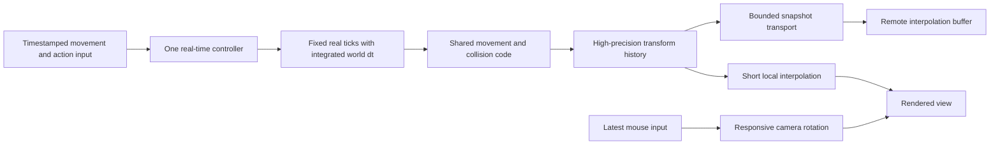

# Slow-motion implementation plan — researched 2026-11-04

This follows [the local architecture audit](SLOW_MOTION_ARCHITECTURE_REVIEW.md).
Target: player displacement and world motion slow together; aiming stays
responsive. The proposal below is a design for STRAFE64, not a reconstruction
of SUPERHOT's source. SUPERHOT's [official press kit](https://superhotgame.com/presskit)
and [Piotr Iwanicki's GDC session description](https://www.gdcvault.com/play/1023483/Game-Design-and-Mind-Control)
establish the movement-driven design goal, but do not establish its timestep,
prediction or interpolation implementation. The session description was read;
the full talk was not reviewed.

## What the primary sources support

| Source | Finding | Application here |
| --- | --- | --- |
| [Unity timeScale API](https://docs.unity.com/en-us/engine/6000.0/script-reference/unityengine/time/timescale) | Scaling fixedDeltaTime with timeScale maintains fixed-update cadence; whether to do so is game-specific. | Preserve real-time movement update frequency through slow motion. |
| [Godot Engine time_scale](https://docs.godotengine.org/en/stable/classes/class_engine.html#class-engine-property-time-scale) | Time scale changes simulated delta without automatically changing physics tick frequency. | Real update cadence and simulated time are separate design variables. |
| [Glenn Fiedler: Fix Your Timestep](https://gafferongames.com/post/fix_your_timestep/) | Accumulate time, bound simulation steps, and interpolate states for rendering; leave CPU headroom and bound catch-up. Fixed simulation steps help reproducibility. | Separate rendering from scheduling and specify an overload policy. |
| [Unity Rigidbody interpolation](https://docs.unity.com/en-us/engine/6000.6/manual/physics-section/physics-overview/rigidbody/rigidbody-interpolation) | Interpolation delays presentation by one physics update; extrapolation can overshoot collision bounds and correct later. | Prefer short interpolation for changing/contact motion over long unconstrained prediction. |
| [Godot advanced interpolation](https://docs.godotengine.org/en/stable/tutorials/physics/interpolation/advanced_physics_interpolation.html#mouse-look) | Camera position can follow an interpolated target while mouse rotation is applied directly each frame. | Keep aiming out of the body-position filter. |
| [Rory Driscoll: Frame Rate Independent Damping](https://www.rorydriscoll.com/2016/03/07/frame-rate-independent-damping-using-lerp/) | Exponential damping expresses a time-dependent response without a per-frame fixed lerp coefficient. | Keep the existing exponential scale-response family; fix its clock/publication contract. |
| [Yahn Bernier, Valve: latency compensation](https://www.gamedevs.org/uploads/latency-compensation-in-client-server-protocols.pdf) | Prediction replays commands from acknowledged state using shared movement code and command duration. | Replay the same command/time history as authority. This link mirrors the original Valve-authored paper; Valve's wiki endpoint returned HTTP 403. |
| [Glenn Fiedler: Snapshot Interpolation](https://gafferongames.com/post/snapshot_interpolation/) | Buffered snapshots absorb arrival jitter; velocity-aware Hermite interpolation can improve sparse position reconstruction. | Keep network reconstruction separate from local physics interpolation; test velocity-aware interpolation later. |

## Decision: fixed real-time cadence, fractional world-time integration

Start with a **125 Hz real-time movement schedule**, behind an opt-in flag for
local listen-server play. This is a candidate to benchmark, not an industry
mandate or a claim that Quake movement already supports it correctly.

At a constant scale:

```text
real step = 8 ms
world step = real step * scale
scale 1.00: 8.00 world ms per step
scale 0.04: 0.32 world ms per step
```

Compared with the existing 8-world-ms movement grid, this trades fewer, larger
slow-motion updates for frequent smaller updates. The design keeps a fixed
schedule in real time, **not a constant world-space solver dt across changing
scales**. It therefore does not inherit all numerical-equivalence/determinism
properties of a constant-world-dt solver. Shared tick/input/scale history and
trajectory tests are required. Unity's pattern supports the cadence choice;
Fiedler's fixed-step guidance does not by itself prove this game's result.

| Alternative | Benefit | Reason not chosen as the default |
| --- | --- | --- |
| Keep 8 world ms, add interpolation | Smallest physics change | At 0.04, neighboring movement states remain about 200 real ms apart; contact/input response stays sparse. |
| Reduce constant world step drastically | Preserves a constant world dt | A 0.32 ms world step also runs 3125 times/s at normal speed; CPU cost needs justification. |
| Variable step once per render | Simple, frequent at high FPS | Makes movement integration depend on render scheduling. |
| Fixed real tick, scaled fractional world dt | Stable update cadence through slowdown | Requires fractional timing and movement/prediction compatibility work; selected for an experimental path. |

Do not simply lower `pmove_msec` or raise `sv_fps`. Command rounding, integer
`pml.msec`, snapshot timing, timers and prediction must agree on the new contract.
The old path remains available until correctness and feel gates pass.

## One clock owner, evaluated independently from network publication

Use one engine-owned time controller. Gameplay/killcam/pause submit requests;
they do not each write the effective scale. Define state transitions and resets.
Intent is timestamped and sampled against real ticks. Base intent on deliberate
input, not scaled observed velocity, to avoid a self-reinforcing freeze.

For a target that remains constant during a segment, use the existing
exponential response with an analytical integral. The following is our
mathematical derivation/application, not a quoted implementation:

```text
s(h) = target + (s0 - target) * exp(-rate * h)
worldDelta = target*h + (s0-target) * (1-exp(-rate*h)) / rate
```

Here h is real seconds, rate is the selected rise/fall rate, and s0 is starting
scale. Use a numerically stable expm1 form for tiny segments. Handle rate zero
as constant scale, and pause as an explicit controller state. Split integration
at timestamped target/ownership changes. Do not apply the final scale to the
whole elapsed interval during a ramp, or apply a newly received input backward
to already elapsed time.

Keep high-precision accumulated world time. For the first implementation, retain
legacy integer timestamps at compatibility boundaries with explicit residuals;
never round the movement/render dt back to whole milliseconds. Introduce a tick
sequence distinct from world time, which may advance very slowly or be paused.

Publish time-state segments/keyframes at a bounded rate, including sequence,
timestamp and the parameters needed to evaluate/recover the clock. Do not solve
the present stepping by continuously writing SYSTEMINFO. The local evaluator
must keep running between publications. Recovery, map reset and demos need an
explicit design before enabling the new path by default.

## Physics, prediction and presentation must share the same timeline



- Movement/gravity/projectiles and appropriate action cooldowns use world dt.
  Remove inverse-scale acceleration compensation only with parity tests and
  after restoring cadence. Specify any real-time grace windows deliberately.
- Prediction replays the same tick durations and time-state history as authority.
  Reading today's scale for all old commands is insufficient during a ramp.
- Sample look each render frame. Mouse deltas represent displacement already;
  do not multiply raw mouse deltas by dt or world scale. Rate-based look inputs
  such as gamepad sticks use real dt. Gameplay aims from timestamped command
  angles, while presentation can use the freshest local look.
- Expose authoritative local transform history at sufficient cadence. The
  current 20 Hz network snapshots must not be mistaken for a 125 Hz local state
  stream. Evaluate a local-only high-rate state path or suitable snapshot rate;
  do not silently force Internet transport to 125 packets/s.
- Start with linear position interpolation and appropriate angular interpolation.
  Interpolate coherent states, rather than independently chasing a target with
  a long low-pass. At 125 Hz, one local simulation interval is 8 real ms; this
  is not a promise of 8 ms total input-to-display latency.
- Preserve fractional player/bot positions in the relevant handoff. Audit the
  existing SnapVector conversions and wire encoding; measure bandwidth effects.
- Reset previous/current render states together on teleports and spawn changes.
  Bound any extrapolation and correction. Hermite is a later option for sparse
  remote samples: collision discontinuities and world-vs-real velocity units
  need explicit handling before applying it.
- Keep AI decision timing separate from movement integration. Slow decisions may
  be desired; stale transforms and sparse contact handling are not required by
  that design. Audio pitch, UI and camera effects get explicit clock policies.

## Research calculation, not an engine validation

A local analytical reference integrated three rise/fall segments over 1.4 real
seconds, beginning at scale 0.04: 0.25 s toward 1 at rate 30, 0.75 s toward 0.04
at rate 8, then 0.4 s toward 1 at rate 30. It split precisely at input changes.
Partitions at 60, 120, 125, 144, 240 and 1000 Hz all accumulated approximately
0.735733515156 world seconds; maximum difference was 1.11e-15 seconds.

The local output is `engine/build/slowmo-clock-research.json`. This establishes
only the numerical consistency of the analytical clock example. It exercises
no engine collision, networking, input sampling latency or GPU presentation.

## Concrete implementation slices

1. **Trace and shared clock core:** add real/world timestamps, scale owner,
   target/effective scale, per-command dt and movement-step traces. Implement
   the shared controller as a tested, opt-in component without changing default
   physics. Cover ramps, rapid reversals, pause, reset and ownership transfer.
2. **Fractional movement prototype:** run player/bot movement at the new real
   cadence; preserve fractional dt through collision and prediction. Replay
   identical recorded inputs across render schedules. Compare normal-speed
   trajectories with the old path before tuning slow motion.
3. **Local render handoff:** coherent transform history, fractional positions,
   separate look rotation, reset semantics. Measure actual render displacement
   and correction spikes on the old Nocturne map.
4. **Network/demo compatibility and tuning:** bounded publication, recovery and
   command replay tests, followed by A/B feel tuning. Do not call the local
   prototype remote-multiplayer or demo-compatible without those checks.

Required scenarios: steady motion, start/stop, reverse, jump/landing, wall slide,
stairs, moving platforms, attack/guard/dash, bot avoidance, death/respawn and
teleport. Run at scales 0.04, 0.05, 0.1, 0.5, 1, through ramps, and with 60/120/
144/240 Hz render schedules plus irregular frame times. Define a bounded catch-up
policy and report overload separately from deliberate slow motion. Benchmark
movement step cost before setting the default cadence.

The next slice is instrumentation plus the clock core, not a larger smoothing
constant. No production simulation code was changed during this research.
